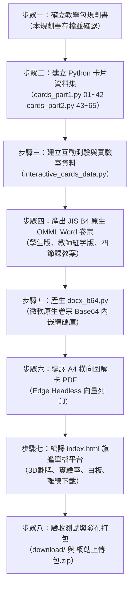

# 東大版 技術高中數學（第三冊）2-3 對數及其運算的意義 課程教學包規劃書

> **專案代號**：PLVS-MATH-DONGDA-SOP-FLAGSHIP  
> **單元名稱**：單元 2-3「對數及其運算的意義」  
> **適用年級**：技術型高級中等學校（技高）二年級 / 技術高中數學（第三冊）  
> **教材來源**：東大版技術型高級中等學校數學第二章 指數與對數 第三節（課本 p.74～p.84）  
> **製作標準**：依據《PLVS-MATH-DONGDA-SOP-FLAGSHIP v4.0 旗艦完備版》十五大核心製作鐵律執行  
> **規劃日期**：2026-10-15  
> **署名**：PLVS 數學科 ‧ 教育學習用  

---

## 壹、單元教學願景與教育設計哲學

### 一、單元學習目標
1. **認知層面**：
   - 理解對數的歷史由來（17 世紀蘇格蘭數學家約翰 ‧ 納皮爾 John Napier 為簡化天文繁瑣計算而發明，化乘除為加減）。
   - 深刻掌握指數與對數的雙向互化核心：$a^x = b \iff x = \log_a b$。
   - 精確熟記對數存在的雙重必要限制：**底數條件**（$a > 0$ 且 $a \neq 1$）與**真數條件**（$b > 0$）。
   - 熟練推導並運用對數基本運算性質、換底公式與連鎖律。
2. **技能層面**：
   - 各類對數精確求值（整數、分數、負數指數、根號底數）。
   - 掌握「質因數分解拆解真數」與「係數還原至真數次方」的雙向化簡能力。
   - 運用基準對數值（如 $\log_{10} 2, \log_{10} 3$）進行未知數符號代換與小數近似逼近。
3. **情意與素養應用**：
   - 體驗對數將跨越數十個數量級的龐大數值（如芮氏地震波能量、聲音分貝、酸鹼值）壓縮為線性尺度的強大威力。
   - 透過「名偵探柯南數理探案」情境，將枯燥抽象符號轉化為抽絲剝繭的解謎樂趣。

---

## 貳、教學痛點、鷹架策略與神技口訣錦囊

### 一、技高學生常見三大痛點與鷹架策略
| 學習痛點 | 常見錯誤與思維陷阱 | 本教學包鷹架式引導策略 |
| :--- | :--- | :--- |
| **底真數條件遺漏** | 解不等式或定義題時，忽略 $a \neq 1$ 或忘記檢查真數 $b > 0$（如把負數代入）。 | 探案情境設定為「雙重防偽安全鎖」，正面提示先設兩道警報線，背面提供數值反例。 |
| **運算符號誤區多** | 誤以為 $\log(M+N) = \log M + \log N$ 或 $\frac{\log M}{\log N} = \log(M-N)$。 | 設計「暗號陷阱辨析卡」，透過具體數值算式直接打臉，加強「乘除才能變加減」的戒律。 |
| **換底連鎖無所適從** | 遇到多項不同底數相乘時不知如何下手。 | 傳授「連鎖骨牌消滅法」與「統一換成以 10 為底」的 SOP 決策樹。 |

### 二、解密口訣錦囊（📜 解密錦囊彈窗收錄）
1. **雙向互化口訣**：
   > **「底數還是底數，指數變對數，對數變指數！」**  
   > （繞一圈法則：以 $a$ 為旋轉中心，$a$ 的 $x$ 次方等於 $b \iff x = \log_a b$）
2. **加減同底口訣**：
   > **「同底相加大結合（真數乘），同底相減大分離（真數除），非乘非除加減不能拆！」**
3. **次方飛翔口訣**：
   > **「真數次方往前飛變分子，底數次方往前飛變分母！」**  
   > 即 $\log_{a^k} (b^m) = \frac{m}{k}\log_a b$。
4. **換底樓上樓下口訣**：
   > **「大家一起分，原底住樓下（分母），真數住樓上（分子）！」**  
   > 即 $\log_a b = \frac{\log_c b}{\log_c a}$。
5. **連鎖骨牌口訣**：
   > **「對角相碰骨牌倒，首尾相連一線通！」**  
   > 即 $\log_a b \times \log_b c \times \log_c d = \log_a d$。
6. **指數抵消口訣**：
   > **「同底雙煞互相消，直接穿透留真數！」**  
   > 即 $a^{\log_a b} = b$。

---

## 參、全套 65 張圖解學習卡知識節點總清單 (CASE 01 ～ CASE 65)

依循 SOP 鐵律 01~03：「堅持一題一卡、一小題獨立成卡、例題隨堂習題全開」：

### 【模組 A：核心概念奠基（CASE 01 ～ CASE 04）】
- **CASE 01**【觀念 01】對數的歷史由來與符號意義（納皮爾、天文計算、$2^x=30$）
- **CASE 02**【觀念 02】對數的定義與存在條件（$a^x=b \iff x=\log_a b$、底數 $a>0, a\neq 1$、真數 $b>0$）
- **CASE 03**【觀念 03】對數五大基本運算性質（$\log_a 1=0, \log_a a=1, \log_a(MN), \log_a(M/N), a^{\log_a M}=M$）
- **CASE 04**【觀念 04】換底公式、連鎖律與倒數性質（換底原理解構、連鎖消去、倒數翻轉）

### 【模組 B：課本例題與隨堂成對實戰（CASE 05 ～ CASE 42，共 38 案）】
- **CASE 05**【例題 1】對數定義辨析（判斷 $\log_1 5, \log_5 1, \log_{-2} 3, \log_2 \frac{1}{5}, \log_3(-4)$ 合法性）
- **CASE 06**【隨堂 1】對數定義辨析（判斷 $\log_2 0, \log_0 2, \log_{\frac{1}{2}} 5, \log_{\frac{1}{2}} \frac{5}{3}, \log_{-3}(-2)$ 合法性）
- **CASE 07**【例題 2】對數存在條件求解（求 $\log_{x-1}(x+5)$ 有意義之 $x$ 範圍）
- **CASE 08**【隨堂 2】對數存在條件求解（求 $\log_{x+2}(3-x)$ 有意義之 $x$ 範圍）
- **CASE 09**【例題 3(1)】對數基礎求值（求 $\log_2 64$）
- **CASE 10**【例題 3(2)】對數基礎求值（求 $\log_3 \frac{1}{81}$）
- **CASE 11**【例題 3(3)】對數基礎求值（求 $\log_{0.1} 0.001$）
- **CASE 12**【例題 3(4)】對數基礎求值（求 $\log_{25} 5$）
- **CASE 13**【隨堂 3(1)】對數基礎求值（求 $\log_3 27$）
- **CASE 14**【隨堂 3(2)】對數基礎求值（求 $\log_2 \frac{1}{32}$）
- **CASE 15**【隨堂 3(3)】對數基礎求值（求 $\log_{\frac{1}{5}} \frac{1}{625}$）
- **CASE 16**【隨堂 3(4)】對數基礎求值（求 $\log_{\frac{1}{4}} 64$）
- **CASE 17**【例題 4(1)】對數基本性質化簡（求 $\log_5 1 + \log_3 3$）
- **CASE 18**【例題 4(2)】對數基本性質化簡（求 $\log_3 \sqrt{3}$）
- **CASE 19**【隨堂 4(1)】對數基本性質化簡（求 $\log_{0.25} 1 + \log_{100} 100$）
- **CASE 20**【隨堂 4(2)】對數基本性質化簡（求 $\log_{25} 125$）
- **CASE 21**【例題 5(1)】對數加法化簡（求 $\log_6 9 + \log_6 4$）
- **CASE 22**【例題 5(2)】對數減法化簡（求 $\log_5 45 - \log_5 9$）
- **CASE 23**【例題 5(3)】對數連續加減化簡（求 $\log_3 36 - \log_3 8 + \log_3 54$）
- **CASE 24**【隨堂 5(1)】對數加法化簡（求 $\log_8 16 + \log_8 32$）
- **CASE 25**【隨堂 5(2)】對數減法化簡（求 $\log_3 18 - \log_3 2$）
- **CASE 26**【隨堂 5(3)】對數連續加減化簡（求 $\log_2 12 + \log_2 40 - \log_2 15$）
- **CASE 27**【例題 6(1)】換底公式求值（求 $\frac{\log_5 32}{\log_5 2}$）
- **CASE 28**【例題 6(2)】換底公式與指數型穿透（求 $5^{\frac{\log_2 7}{\log_2 5}}$）
- **CASE 29**【例題 6(3)】指數與對數綜合化簡（求 $9^{\log_3 5}$）
- **CASE 30**【隨堂 6(1)】換底公式求值（求 $\frac{\log_2 243}{\log_2 9}$）
- **CASE 31**【隨堂 6(2)】換底公式與指數型穿透（求 $4^{\frac{\log_7 1}{\log_7 3}}$）
- **CASE 32**【隨堂 6(3)】指數與對數綜合化簡（求 $3^{\log_9 16}$）
- **CASE 33**【例題 7(1)】對數連鎖律求值（求 $\log_2 5 \times \log_5 2$）
- **CASE 34**【例題 7(2)】對數連鎖律多重相乘（求 $\log_2 3 \times \log_3 5 \times \log_5 8$）
- **CASE 35**【隨堂 7(1)】對數連鎖律求值（求 $\log_4 6 \times \log_6 4$）
- **CASE 36**【隨堂 7(2)】對數連鎖律多重相乘（求 $\log_9 8 \times \log_8 7 \times \log_7 3$）
- **CASE 37**【例題 8(1)】基準對數代數表示（設 $\log_{10} 2=x, \log_{10} 3=y$，以 $x, y$ 表示 $\log_{10} 12$）
- **CASE 38**【例題 8(2)】基準對數代數表示（以 $x, y$ 表示 $\log_{10} \frac{8}{9}$）
- **CASE 39**【例題 8(3)】換底綜合代數表示（以 $x, y$ 表示 $\log_3 40$）
- **CASE 40**【隨堂 8(1)】基準對數代數表示（設 $\log_{10} 3=x, \log_{10} 5=y$，以 $x, y$ 表示 $\log_{10} 45$）
- **CASE 41**【隨堂 8(2)】基準對數代數表示（以 $x, y$ 表示 $\log_{10} \frac{25}{27}$）
- **CASE 42**【隨堂 8(3)】換底綜合代數表示（以 $x, y$ 表示 $\log_{30} 15$）

### 【模組 C：章末自我評量習題全集（CASE 43 ～ CASE 65，共 23 案）】
- **CASE 43**【是非 1】$\log_a 1 = 0$ 恆成立判斷（○）
- **CASE 44**【是非 2】$\log_a(M+N) = \log_a M + \log_a N$ 謬誤判斷（×，數值反例）
- **CASE 45**【是非 3】$\frac{\log_a M}{\log_a N} = \log_a(M-N)$ 謬誤判斷（×，數值反例）
- **CASE 46**【是非 4】$\log_3(-3)^2 = 2\log_3(-3)$ 負數真數陷阱判斷（×，負數無對數）
- **CASE 47**【是非 5】$b>0 \implies \log_{10} b > 0$ 恆正盲點判斷（×，真數介於 0~1 對數為負）
- **CASE 48**【習題 1】對數存在範圍（求 $\log_{x-2}(7-x)$ 有意義之 $x$ 範圍）
- **CASE 49**【習題 2(1)】基礎對數求值（求 $\log_{10} 10 + \log_{10} 1$）
- **CASE 50**【習題 2(2)】根號與小數對數求值（求 $\log_{\sqrt{2}} 2 + \log_9 \sqrt{3} - \log_{0.5} 0.125$）
- **CASE 51**【習題 3(1)】對數加法化簡（求 $\log_{12} 4 + \log_{12} 36$）
- **CASE 52**【習題 3(2)】對數加減綜合（求 $\log_{10} 25 + \log_{10} 12 - \log_{10} 3$）
- **CASE 53**【習題 3(3)】係數還原至次方化簡（求 $2\log_5 10 - 4\log_5 2 + \log_5 20$）
- **CASE 54**【習題 4(1)】換底與指數穿透（求 $4^{\frac{\log_7 16}{\log_7 4}}$）
- **CASE 55**【習題 4(2)】指數減法換底化簡（求 $3^{\log_9 20 - \log_9 5}$）
- **CASE 56**【習題 4(3)】巢狀對數由內而外求值（求 $\log_9 (\log_2 8)$）
- **CASE 57**【習題 5】對數多重連鎖律（求 $\log_9 7 \times \log_7 100 \times \log_{10} 3$）
- **CASE 58**【習題 6】進階代數換底代換（設 $a=\log_{10} 2, b=\log_{10} 3$，以 $a, b$ 表示 $\log_{12} 5$）
- **CASE 59**【習題 7(1)】常用對數近似值運算（求 $\log_{10} 6$）
- **CASE 60**【習題 7(2)】常用對數互補換算（求 $\log_{10} 5 = 1 - \log_{10} 2$）
- **CASE 61**【習題 7(3)】常用對數除法逼近（求 $\log_{10} \frac{3}{2}$）
- **CASE 62**【習題 8】指數對數聯手求值（設 $x=\log_{10} 5$，求 $100^x + 10^{-x}$）
- **CASE 63**【習題 9】對數多項式乘法展開（求 $(\log_2 3 + \log_4 9)(\log_3 4 + \log_9 2)$）
- **CASE 64**【習題 10(1)】芮氏地震能量素養應用（$\log_{10} E = 11.8 + 1.5M$，求釋放 $10^{19.3}$ 爾格之規模 $M$）
- **CASE 65**【習題 10(2)】921 大地震規模 7.3 能量計算（求震央釋放之總能量 $E$ 爾格）

---

## 肆、遊戲化互動實驗室與闖關系統設計

### 一、阿笠博士動態探案實驗室（3 大子模組）
1. **子模組 A：動態對數與指數曲線消長儀**：
   - 互動滑桿控制底數 $a$（範圍 $0.1 \sim 5.0$），可切換 $a > 1$（嚴格遞增）與 $0 < a < 1$（嚴格遞減）。
   - 動態繪製 $y = \log_a x$ 曲線，即時標記關鍵定點 $(1,0)$、漸近線 $x=0$，以及與指數函數 $y = a^x$ 關於直線 $y=x$ 的對稱幾何鏡像。
2. **子模組 B：芮氏地震能量波形模擬器（素養遊戲化）**：
   - 滑桿拖曳震度規模 $M$（$3.0 \sim 9.0$），即時依據公式 $\log_{10} E = 11.8 + 1.5M$ 計算能量 $E$。
   - 動態換算比較：相當於多少顆廣島原子彈能量（每顆約 $6.3 \times 10^{20}$ 爾格）或多少公噸黃色炸藥（TNT），視覺化展示「規模每差 1 階，能量暴增 31.6 倍；規模差 2 階，能量差 1000 倍」的對數震懾力！
3. **子模組 C：60秒對數基本運算速算破案挑戰 (Speed Drill)**：
   - 60 秒倒數計時，題庫隨機抽取對數求值題目（如 $\log_2 16, \log_3 \frac{1}{27}, \log_{25} 5$）。
   - 提供 8 大常見答案快速點選九宮格，支援鍵盤快捷鍵（數字 1~8）。
   - Combo 連擊加分與即時音效回饋，破案後依積分頒發「柯南特等顧問偵探證書」。

### 二、少年偵探團升級特訓考核（密室逃脫 6 階段闖關）
- **STAGE 01：對數概念探索關（5 題）**：對數定義、指數互換、底真數存在條件檢驗。
- **STAGE 02：對數性質運算關（5 題）**：積變和、商變差、次方前推與化簡。
- **STAGE 03：換底與連鎖突破關（5 題）**：換底公式、連鎖消滅律、指數對數穿透。
- **STAGE 04：常用對數與估算關（5 題）**：常用對數近似值、代數符號轉換。
- **STAGE 05：課後習作實戰關（10 題）**：是非題辨析與章末核心精選題。
- **STAGE 06：終極深水魔王關（10 題抽籤）**：涵蓋地震生活素養題、多項式乘法展開，配置 3 顆手錶麻醉針指針生命值（❤️），全數過關解鎖結案勳章。

---

## 伍、微軟原生 OMML Word 卷宗與教案規格

1. **JIS B4 橫向雙欄學生實作單（`學生學習單.docx`）**：
   - 採用 JIS B4 橫向雙欄（364mm × 257mm），不設 2 頁限制，預估 4 頁排版。
   - 包含：觀念填空檢驗、例題隨堂雙欄對照留白、全套章末習題實戰演練、錯題反思區。
   - 100% 微軟原生 OMML 方程式，杜絕任何純文字鍵盤打字。
2. **JIS B4 橫向雙欄教師解答版（`教師解答版.docx`）**：
   - 完整標註【👓 名偵探破案解析 ‧ CASE CLOSED】。
   - 解答文字與 OMML 數學式統一標註醒目領結紅（`#DC2626`）。
   - 產生完成後自動編碼為 Base64 內嵌於單檔網頁中，受密碼 `88888888` 保護。
3. **JIS B4 直式單欄四節課教學計畫與教案（`四節課教學計畫與教案.docx`）**：
   - 第一節（50 分鐘）：對數由來與符號意義、指數與對數互換、底數與真數存在條件（CASE 01~08）。
   - 第二節（50 分鐘）：對數基本運算性質（真數相乘變相加、相除變相減、次方前推化簡）（CASE 09~26）。
   - 第三節（50 分鐘）：換底公式推導、連鎖律骨牌消滅法與基準對數代數表示（CASE 27~42）。
   - 第四節（50 分鐘）：是非觀念診斷、芮氏地震生活素養應用與深水闖關特訓考核（CASE 43~65）。

---

## 陸、後續標準工程管線與實作步驟

